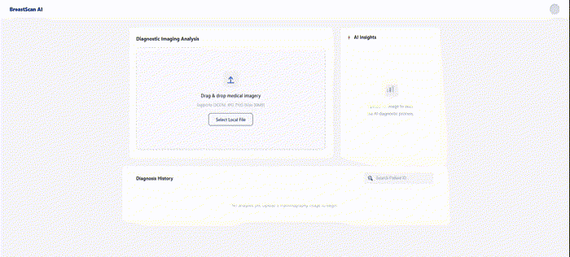
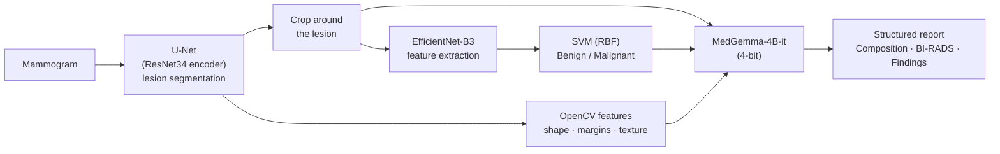
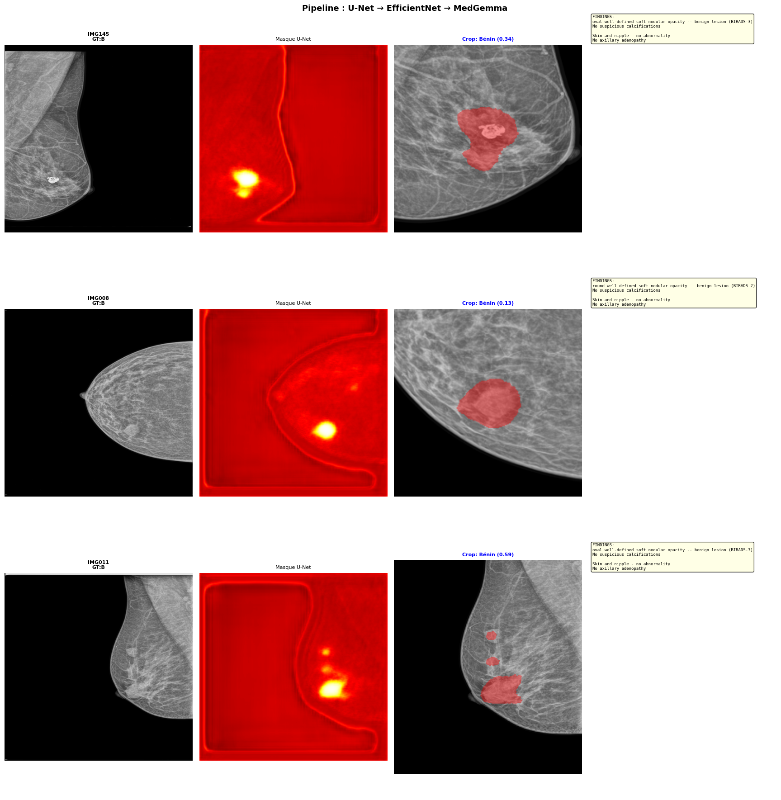
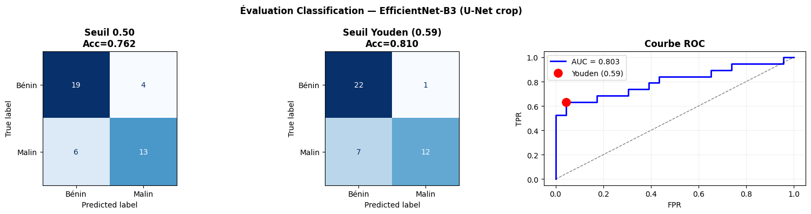
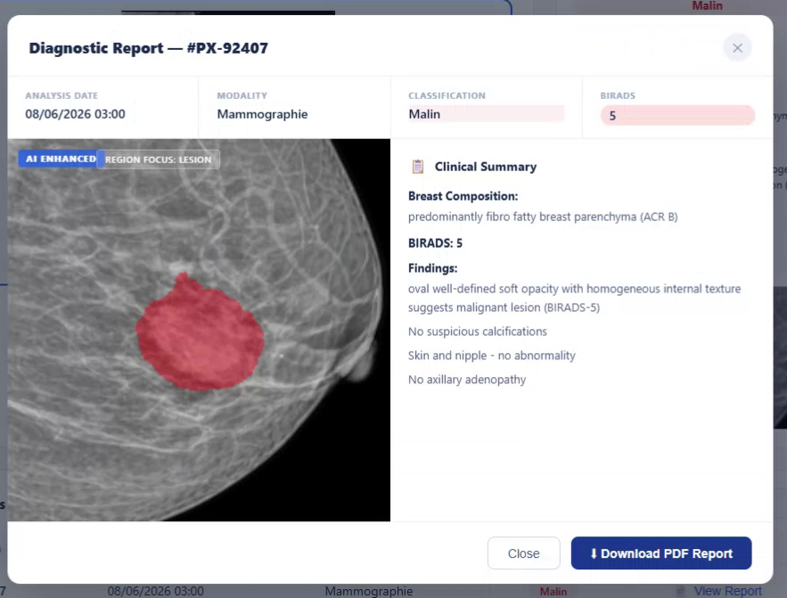
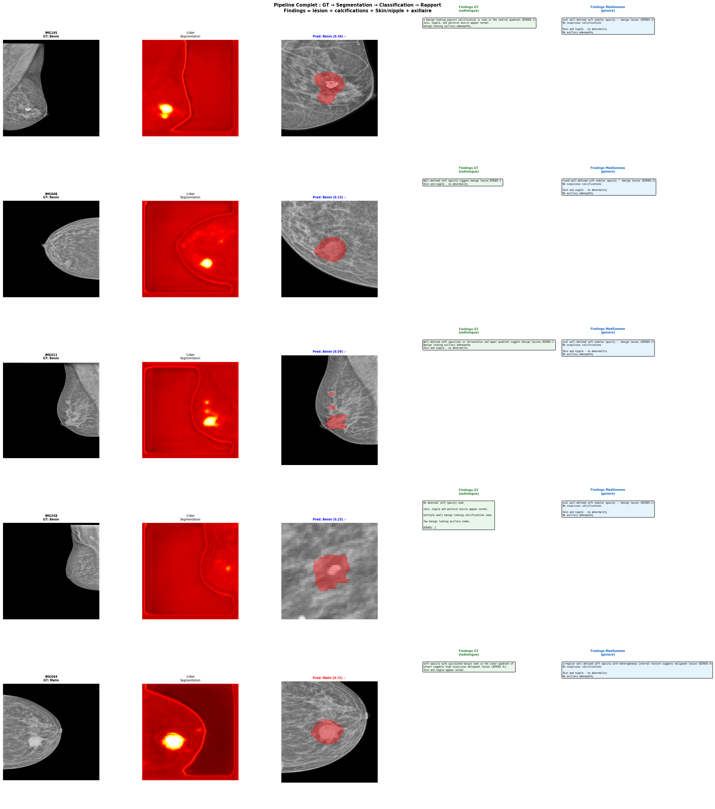
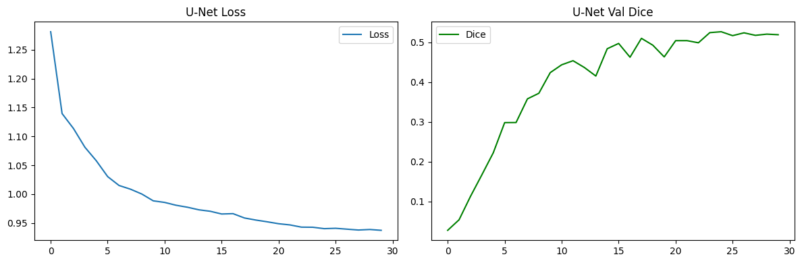
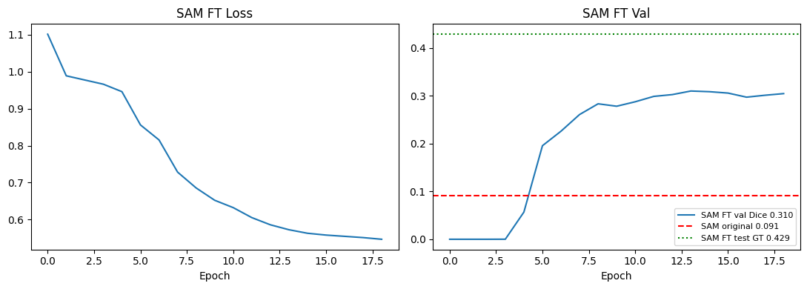

# 🩺 Automated Mammography Report Generation

AI pipeline that analyses a mammogram, **segments the lesion**, **classifies it as benign or malignant** and **writes a structured
radiology report** with a medical vision-language model (**MedGemma**). Results are served through a Flask API and displayed in an Angular web app.




> **Research prototype — not intended for clinical use.** The generated reports are a decision-support aid and must be reviewed by a radiologist.

This repository contains the **report generation module** of a team end-of-year project (PFA) carried out at the
**CRNS Brain4ICT research lab** (Sfax). The full platform also included a natural-language interface to the medical database
(Text-to-SQL), developed by other team members and not included here.

---

## 🔬 Pipeline



| Step | Model / method | Details |
|---|---|---|
| **Segmentation** | U-Net, ResNet34 encoder (`segmentation-models-pytorch`) | Fine-tuned on DMID lesion masks (256×256) |
| **Classification** | EfficientNet-B3 (ImageNet) as a feature extractor + **SVM RBF** | 1536-dim features from the U-Net crop, **SMOTE** to balance classes, decision threshold chosen with Youden's J |
| **Radiological features** | OpenCV on the predicted mask | Circularity, solidity, contrast, internal texture → shape, margins, heterogeneity |
| **Report generation** | **google/medgemma-4b-it**, 4-bit quantization (bitsandbytes) | Input: lesion crop with mask overlay + classification + features. Output follows the DMID radiologist report format |
| **Serving** | Flask API (`/predict`) on Colab GPU, exposed with ngrok | Consumed by the Angular front-end |

**Model selection.** Several vision-language models were benchmarked (LLaVA-Med, CheXagent-8B, LLaVA 1.5, MedGemma): MedGemma gave the most
detailed and best-structured reports. SAM (`facebook/sam-vit-base`) was also tested for segmentation, but even after fine-tuning its mask decoder
(validation IoU 0.31) it stayed below U-Net, which was kept.

## 📊 Results (test set: 42 images — 23 benign, 19 malignant)

**Classification** (EfficientNet-B3 + SVM on U-Net crops)

| AUC | Accuracy | Sensitivity (malignant) | Specificity | Precision (malignant) |
|---|---|---|---|---|
| **0.80** | **0.81** | 0.63 | 0.96 | 0.92 |

**Report generation** — MedGemma *Findings* compared with the radiologist's *Findings* on the 42 test images

| ROUGE-1 | ROUGE-2 | ROUGE-L | BLEU-1 | BERT cosine similarity |
|---|---|---|---|---|
| 0.44 | 0.20 | 0.37 | 0.24 | **0.71** |

**Segmentation** (U-Net) — best validation Dice **0.53**, test Dice 0.47. Small or low-contrast lesions remain the main difficulty.

| Pipeline on test images | Classification evaluation |
|---|---|
|  |  |

<details>
<summary>More figures</summary>

**Generated report in the web app**



**Radiologist report vs MedGemma**



| U-Net training | SAM fine-tuning |
|---|---|
|  |  |

</details>

## 🗂️ Dataset

[**DMID** — Digital Mammography Dataset for Breast Cancer Diagnosis Research](https://figshare.com/articles/dataset/_b_Digital_mammography_Dataset_for_Breast_Cancer_Diagnosis_Research_DMID_b_DMID_rar/24522883):
mammograms, lesion masks, radiologist reports and metadata. 274 images with benign or malignant annotations were used, split **by image**
(70 / 15 / 15 %, stratified) so that no image appears in two sets. The dataset is not redistributed here: download it from the link above.

## 📁 Repository structure

```
├── notebooks/
│   ├── 01_training_segmentation_classification.ipynb   U-Net, EfficientNet-B3 + classifier, SAM experiments
│   └── 02_pipeline_report_generation_api.ipynb        Full pipeline, MedGemma reports, evaluation, Flask API
├── frontend/                                          Angular 16 web app (upload, results, report, history)
├── docs/                                              Demo and figures
└── requirements.txt
```

## 🚀 How to run

**1. Notebooks (Google Colab with a GPU)**
1. Download DMID and place it in your Google Drive under `PFA/DMID/` (the notebooks expect `PFA/DMID/512/TIFF`, `PFA/DMID/512/Mask`, `PFA/DMID/Reports` and `PFA/DMID/Metadata.xlsx`).
2. Accept the MedGemma terms on [Hugging Face](https://huggingface.co/google/medgemma-4b-it).
3. In Colab, add two secrets (🔑 icon): `HF_TOKEN` (Hugging Face) and `NGROK_TOKEN` (ngrok).
4. Run `01_training_...` to train and save the U-Net and the classifier in `PFA/models/`, then run `02_pipeline_...`. Its last cell starts the API and prints a public URL.

**2. Front-end**
```bash
cd frontend
npm install
# paste the URL printed by the notebook in src/environments/environment.ts
npx ng serve --open      # http://localhost:4200
```

Trained weights are not included in the repository.

## 👩‍💻 Authors

End-of-year project (PFA) — IIT Sfax, 2025/2026, supervised by Dr. Wael Ouarda (CRNS, Brain4ICT).

- **Chaima Maatar** — report generation module (this repository) · [GitHub](https://github.com/MaatarChaima)
- **Salha Hentati**
- **Zeinab Gharbi**
- **Nour Houda Jarboui**
